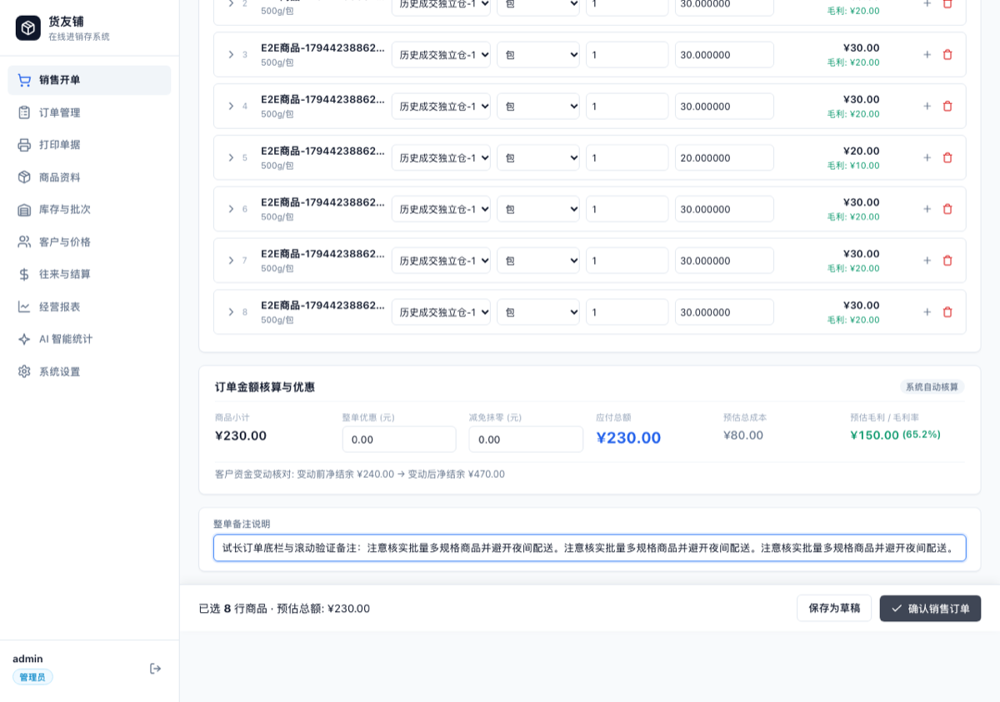
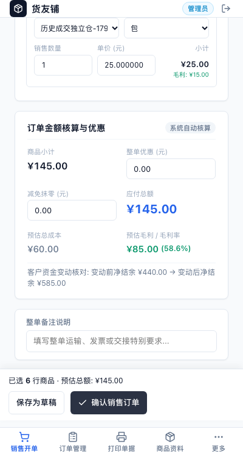
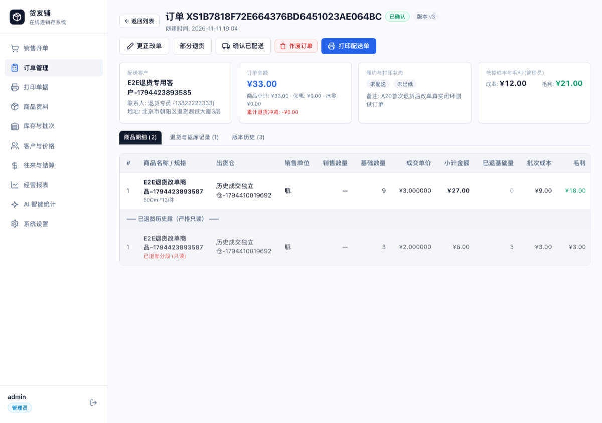

# 货友铺 (HuoYouPu)

面向单商家的在线进销存系统。刻意保持极简流程：**确认订单即扣库存、即计成本与毛利、即记客户应收**；收款与配送解耦，不存在"下单 → 审核 → 派送 → 收款"的分段推进，也没有派送审批环节。

同一套网页在电脑和手机上都能用，按管理员 / 员工两种角色授权。TypeScript 全栈，React 前端，Fastify + PostgreSQL 后端。



*销售开单：多行商品、逐行配置仓库与批次、整单优惠与毛利实时核算。*



*同一会话在手机端：底部固定「保存为草稿 / 确认销售订单」，确认后库存、成本、应收一次生效。*



*订单详情：退货后的只读历史段与可修改部分分开显示，成本与毛利仅管理员可见。*

以上均为**实际运行截图**，不是设计稿。更多设计参考与实现对照见 [`docs/ui/`](docs/ui/)。

---

## 它解决什么

进销存系统常见的重量级流程是：录单 → 审核 → 分配库存 → 发货 → 对账 → 收款，每一步都要人工推进。小店实际上不需要这些关卡，需要的是**开单当场就把账算准**。

这个系统把一次销售确认当作唯一的记账入口：确认那一刻，库存扣减、批次成本、销售毛利、客户应收**同时生效**，要么全部成立，要么整单不生效——不会出现扣了库存却没记应收的半成品状态。

需要事后更正时，走"改单"而不是删单：修改保留版本历史，重算受影响金额与成本，未变更明细保持原分配。配送单打印、实际返库、实际退款都是**独立记录**的事实，不覆盖也不伪造已经发生的现金。

---

## 功能一览

| 能力 | 说明 | 规格 |
| --- | --- | --- |
| 账号与权限 | 管理员 / 员工两角色；员工只能看订单与打印，服务端直接剥离成本、毛利与进货价 | [spec](openspec/specs/access-control/spec.md) |
| 商品与单位 | 商品、条码、整数单位换算；`500ml酱油 → 500mljy` 拼音助记码检索 | [spec](openspec/specs/product-catalog/spec.md) |
| 客户与价格 | 一个客户多个配送地址；成交价按"最近有效成交价 → 客户专属价 → 默认售价"回填并注明来源 | [spec](openspec/specs/customers-pricing/spec.md) |
| 分仓批次库存 | 按商品 + 仓库 + 批次记录余量与实际成本；FIFO 自动消耗，支持手选、补录入库、独立盘点损益 | [spec](openspec/specs/inventory-batches/spec.md) |
| 销售开单 | 同一会话多选商品，逐行配置仓库 / 单位 / 数量 / 单价 / 批次方式；草稿可另存，确认即记账；支持改单、作废、整单优惠与抹零 | [spec](openspec/specs/sales-orders/spec.md) |
| 销售退货 | 按原订单明细部分退货，按原仓原批原成本回补；退货确认、实际返库、实际退款三者分开记录 | [spec](openspec/specs/sales-returns/spec.md) |
| 往来与结算 | 客户欠款与可用余额分离；支持分次收款、一单分次、一笔结多单、余额抵扣与月结对账 | [spec](openspec/specs/customer-settlements/spec.md) |
| 配送单打印 | 可配置纸型、字段、列宽、行高与版本；打印行为不影响库存与利润 | [spec](openspec/specs/delivery-printing/spec.md) |
| 报表 | 销售、商品客户、仓库批次、损益、资金统一口径，支持同期对比与来源钻取 | [spec](openspec/specs/business-reporting/spec.md) |
| AI 统计 | 自然语言转受控查询意图，只选获准的指标与维度，结果可追溯到明细；不执行任意 SQL，不写业务数据 | [spec](openspec/specs/ai-reporting/spec.md) |

业务术语统一见 [GLOSSARY.md](GLOSSARY.md)。

---

## 架构

```
apps/api/           Fastify API：鉴权、业务模块、迁移执行、审计与幂等
apps/web/           React 19 + Vite：页面、交互、打印预览
packages/contracts/ OpenAPI 生成类型 + Ajv 运行时校验（含角色字段投影）
packages/database/  node-postgres + Drizzle schema、checksum 迁移、隔离测试夹具
packages/money/     bigint 分 / 百万分之一元、单位换算、比例分摊与尾差
```

模块化单体：`apps/api/src/modules/` 下按 `auth / catalog / inventory / sales / finance / reporting / printing / ai` 划分，各模块导出注册函数，由 API 单一入口装配。所有写入经同一 `withOperation` 通道，携带幂等键、事务、来源审计与结果缓存。

**精度约定**：金额为 `bigint` 分（`numeric(20,2)`），单价为百万分之一元（`numeric(20,6)`），数量与倍率是安全整数。比例分摊用整数有理数做 half-up，末批承接全部余分——"10 元 / 24 瓶"逐瓶售卖再逐瓶退回，金额与成本都能精确回到 1000 分。

**契约驱动**：`docs/contracts/api-contract.openapi.json` 是唯一的机器契约活源，`packages/contracts` 由它生成类型与校验器。前后端都只依据这份契约，不互相猜字段。

---

## 快速开始

前置：**Node.js ≥ 22**，**PostgreSQL 18**（测试与夹具脚本会硬性检查 18.x）。Apple Silicon 可用 `brew install postgresql@18`，必要时设 `PG_BIN=/opt/homebrew/opt/postgresql@18/bin`。

```sh
npm ci --ignore-scripts
```

### 路线 A：用虚构数据直接看界面（推荐先跑这条）

不需要建库、不需要准备账号，脚本会起一个私有临时 PostgreSQL 集群，写入全套虚构商品、客户、入库批次与订单：

```sh
npm run dev:fixture   # 终端 1：临时 PG + 虚构数据 + API（127.0.0.1:3000）
npm run dev:web       # 终端 2：Vite（http://localhost:5173）
```

`dev:fixture` 就绪后会打印一个 `credentialsFile` 路径，里面是本次随机生成的 `admin` / `employee` 登录凭据。该文件在仓库外的私有临时目录（`/tmp/huoyoupu-dev-*`，`0700`），进程退出时连同临时集群一起清理。它只接受 3000 端口空闲的情况，不会杀掉占用端口的进程。

### 路线 B：连自己的数据库做开发

```sh
cp .env.example .env          # 填入你自己的开发库与 HTTPS origin
npm run db:migrate            # 应用 packages/database/migrations 下的迁移

# 初始化首个管理员：密码写入私密文件（0600），不放进命令参数或仓库
umask 077
printf '%s\n' '你的开发用密码' > /tmp/hyp-admin-password
HYP_ADMIN_LOGIN=admin HYP_ADMIN_PASSWORD_FILE=/tmp/hyp-admin-password \
  DATABASE_URL='postgresql://user@localhost/huoyoupu' npm run admin:init

DATABASE_URL='postgresql://user@localhost/huoyoupu' npm run dev:api   # 终端 1
npm run dev:web                                                      # 终端 2
```

注意：会话 Cookie 固定带 `Secure`，因此浏览器登录需要真实 HTTPS 的 origin；纯 HTTP 只够跑 `/health` 探测。Node 不会自动读 `.env`，可用 `node --env-file=.env`。

### 常用命令

| 命令 | 作用 |
| --- | --- |
| `npm run typecheck` | 构建 + 全部 workspace 严格类型检查 |
| `npm run test:unit` | 纯逻辑测试（不需要数据库） |
| `npm run test:db` | 真实 PostgreSQL 测试，自建临时集群，不触碰任何开发库 |
| `npm run build` | 依次构建 contracts → money → database → api → web |
| `npm run dev:fixture` / `dev:api` / `dev:web` | 本地开发入口 |

---

## 部署

`Dockerfile` 有两个目标：`--target runtime`（API 镜像）与 `--target web`（React 静态资源 + Caddy）。`infra/compose.yaml` 提供 `db` / `migrate` / `api` / `initialize-admin` / `proxy` 五个服务，密码通过 Compose secret 文件挂载，不明文写入环境变量或镜像。

只有 Caddy 发布 80/443，API 与 PostgreSQL 不对外暴露端口。迁移先于 API 启动，失败不放行；更新时保留数据卷、先备份再迁移。

完整步骤、备份恢复与证书说明见 [部署说明](docs/deployment.md)。

---

## 文档地图

| 想了解 | 看这里 |
| --- | --- |
| 业务规则（唯一来源） | [`openspec/specs/`](openspec/specs/) |
| 接口契约（活源） | [API 契约说明](docs/contracts.md) · [OpenAPI JSON](docs/contracts/api-contract.openapi.json) |
| 后端开发与精度约定 | [后端开发](docs/backend-development.md) |
| 工作区与本地命令 | [工作区运行](docs/workspace-development.md) |
| 销售、库存、资金、打印、报表的边界 | [销售事务](docs/sales-transactions.md) · [库存](docs/inventory.md) · [资金](docs/finance.md) · [打印](docs/printing.md) · [报表](docs/reporting.md) |
| 安全、会话与初始化 | [账号与关键操作](docs/security-operations.md) |
| 部署与恢复 | [部署说明](docs/deployment.md) |
| 设计稿与实现截图 | [`docs/ui/`](docs/ui/) |
| 历次验收记录 | [`docs/verification/`](docs/verification/) |
| 给 AI Agent 的协作规则 | [AGENTS.md](AGENTS.md) |

### 关于这个仓库的协作方式

需求先写成可测试的规格，再分头实现：**后端只写 API、数据库与契约，前端只写页面与交互，两边以契约对接**，不允许同时修改同一文件。规格变更走 OpenSpec（提案 → specs → design → tasks → 归档），归档后历史固化在 `openspec/changes/archive/`，活规格在 `openspec/specs/`。

这也是仓库里有 `openspec/`、`docs/verification/`、`docs/ui/` 这些目录的原因：规格、验收证据与设计稿都是一等公民。具体规则见 [AGENTS.md](AGENTS.md)。

---

## 项目状态

核心功能与十项能力规格已实现并归档，53 条业务要求各自带有可测试场景。仓库当前的实际验证结果：

- `npm run typecheck` 通过（五个 workspace，严格模式含 `noUncheckedIndexedAccess`、`exactOptionalPropertyTypes`）
- `npm run test:unit` 37/37 通过
- `npm run test:db` 114/114 通过（真实 PostgreSQL 18，临时隔离集群）
- `npm run build` 通过，前端产物约 663 KB（gzip 162 KB）
- 契约生成一致性检查通过（153 个 schema、79 个 operation）
- `openspec validate --specs --strict` 通过（10 项能力，53 条要求）

尚未完成或需要真实环境的事项：公网域名与 ACME 证书签发、真实 Linux 生产宿主上的发布、物理打印机的实纸输出。这些不能由本地或隔离环境的结果替代。

## 许可

[MIT](LICENSE)
