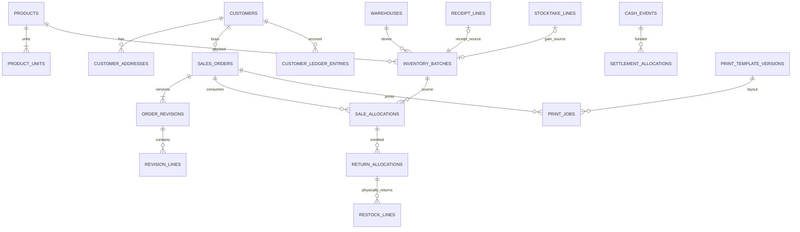

# 数据库设计

本文件描述 apply 阶段应实现的 PostgreSQL/Drizzle 模型，不是已执行迁移。业务规则见各 capability specs，事务与状态见 [design.md](../design.md)，HTTP 字段见 [API 契约](api-contract.md)。

## 公共类型与约定

- 主键 `uuid`；业务单号独立、唯一、不可当作内部关联主键。
- `quantity`、`quantity_base`、倍率与版本为 bigint，输入及对外输出不得超过 9,007,199,254,740,991；数量写入必须为整数，倍率大于零。
- 金额 `numeric(20,2)`，单价和输入成本 `numeric(20,6)`；服务端高精度换算保留原成本与倍率。API 使用十进制字符串，禁止数据库浮点货币列。
- 时间 `timestamptz`；业务时间与 `recorded_at` 分列，默认报表时区 Asia/Shanghai。
- 可变资料含 `created_at / updated_at / version`；停用不删除历史引用。单据快照、金额流水及审计追加保存。
- 单商家不添加虚假的多租户维度。成本和毛利是服务端敏感字段，不因同库存在就允许员工读取。

## 核心关系

图中的实体名是阅读名；实际表名以下表为准。盘盈批次来源是盘点明细，不强制伪造采购入库行。

## 账号、资料与配置

| 表 | 关键字段与关系 | 约束及用途 |
| --- | --- | --- |
| `users` | id、login_name、password_hash、role(admin/employee)、active、version、timestamps | login_name 规范化唯一；至少保留一个有效管理员；不保存明文密码 |
| `sessions` | id、user_id FK nullable、token_hash、csrf_token_hash、expires_at、revoked_at、created_at | 未登录挑战无 user，登录后轮换；token_hash 唯一；只设置安全会话 Cookie，库和日志不存明文 token |
| `company_profiles` | id、name、phone、address、default_template_id nullable、version | 单商家资料及默认模板，打印所需公开字段；不包含模型密钥 |
| `products` | id、code、normalized_code、name、specification、brand、generated_mnemonic、mnemonic_override、effective_mnemonic、base_unit_id、active、version | normalized_code 唯一；助记码非唯一；改名更新自动值，未提交新覆盖则清除旧覆盖 |
| `product_units` | id、product_id FK、name、multiplier_base、default_sale_price、default_receipt_cost、active、version | 商品内名称唯一；基础倍率为 1；交易引用后倍率不可原地改义 |
| `product_barcodes` | id、product_id FK、unit_id FK、barcode_value | 条码字符串唯一，保留前导零；单位必须属于该商品 |
| `customers` | id、code、name、contact_name、phone、notes、active、version | code 唯一，客户是统一往来主体 |
| `customer_addresses` | id、customer_id FK、label、contact_name、phone、address、is_default、active、version | 同客户最多一个有效默认地址；历史订单使用快照 |
| `customer_price_rules` | customer_id FK、product_id FK、unit_id FK、unit_price、version | 三者唯一且单位归属正确；优先级在历史有效成交价之后 |
| `warehouses` | id、code、name、active、version | code 唯一；有余量或活动来源时不直接删除 |

`products.base_unit_id` 与 `product_units.product_id` 的相互关系在同事务建立，使用可延迟约束或两步初始化后校验；不能留下没有基础单位的可交易商品。

## 入库、库存与盘点

| 表 | 关键字段与关系 | 约束及用途 |
| --- | --- | --- |
| `receipts` | id、receipt_no、kind(purchase/opening)、warehouse_id、supplier_reference、received_at、recorded_at、operator_id、operation_id | 已确认入库头，单号唯一；实际时间可补录，不晚于登记时的实际当前时间 |
| `receipt_lines` | id、receipt_id、product_id、unit_id、quantity、multiplier_snapshot、quantity_base、input_unit_cost、cost_amount | quantity > 0；成本非负；保留成本的输入单位与换算依据 |
| `inventory_batches` | id、product_id、warehouse_id、source_kind(receipt/stocktake_gain)、receipt_line_id FK nullable、stocktake_line_id FK nullable、received_at、recorded_at、cost_unit_id、multiplier_snapshot、input_unit_cost、initial_quantity_base、remaining_quantity_base、initial_cost_amount、remaining_cost_amount、version | 两个来源 FK 恰有一个，分别唯一；API sourceLineId 为来源投影；余量及剩余成本非负，不以时间作主键 |
| `stock_balances` | product_id、warehouse_id、quantity_base、cost_amount、version | 商品仓库联合主键；同事务维护批次合计，并作为分配/入库/盘点的锁定锚点 |
| `stock_movements` | id、operation_id、source_kind、source_id、source_line_id、batch_id、product_id、warehouse_id、quantity_delta_base、cost_delta_amount、balance_after_base、recorded_at、operator_id、effect_slot | 追加流水；来源与 effect_slot 唯一防重；正负数量必须和实际成本来源一致 |
| `stocktakes` | id、stocktake_no、warehouse_id、counted_at、status(draft/confirmed)、version、operator_id、operation_id | 不预留或冻结整个仓库；确认使用受盘点批次版本校验 |
| `stocktake_lines` | id、stocktake_id、product_id、batch_id nullable、snapshot_quantity_base、snapshot_batch_version、actual_quantity_base、difference_base、gain_cost_unit_id、gain_unit_cost | 盘亏指定原批；盘盈差额创建新批且必须给成本；resultBatchId 通过批次来源查询投影，避免双向必填依赖 |

确认盘点时重新校验快照。正差保留原批账面来源并额外建立盘盈差额批次，不覆盖原批历史成本；负差扣指定批次。相同商品仓库多行的差异在一次事务合并核对，避免重复计差。

## 订单、版本与消耗来源

| 表 | 关键字段与关系 | 约束及用途 |
| --- | --- | --- |
| `sales_orders` | id、order_no、status(draft/confirmed/voided)、customer_id、current_revision_id、version、confirmed_at、delivery_status、delivered_at、created_by、timestamps | order_no 唯一；confirmed_at 首次确认后不改；配送标记不产生销售或库存流水 |
| `order_lines` | id、order_id、created_at | 稳定逻辑行标识，允许同商品多行及多仓，不对 order_id + product_id 设唯一 |
| `order_revisions` | id、order_id、revision_no、customer_id、address_id、customer_snapshot、address_snapshot、subtotal_amount、discount_amount、round_off_amount、total_amount、cost_amount、gross_profit、change_reason、created_at、created_by、operation_id | order_id + revision_no 唯一；不可覆盖；金额为有效销售、尚未扣独立退货信用额 |
| `revision_lines` | id、revision_id、line_id、position、kind(normal/derived/return_history)、product_id、warehouse_id、unit_id、input_quantity nullable、quantity_base、multiplier_snapshot、unit_price、product_snapshot、subtotal_amount、discount_allocated、net_amount、cost_amount、gross_profit、locked_return_snapshot | revision + line 唯一；普通输入数量整数，派生历史段可只保存基础整数数量；锁定已退来源与金额 |
| `sale_allocations` | id、order_id、line_id、batch_id、issue_sequence、created_revision_id、issued_quantity_base、issued_cost_amount、released_quantity_base、released_cost_amount、returned_quantity_base、return_credit_cost_amount、restocked_quantity_base、restocked_cost_amount、version | 原消耗段不可改来源，累计量/金额受上限约束；可更新计数但每次有追加来源流水 |
| `revision_allocation_links` | revision_line_id、sale_allocation_id、quantity_base、cost_amount | 版本与原段之间的引用；复用不是再次扣库；当前版本总量及成本须可对账 |

核心检查：

1. 当前有效商业数量 = 累计原消耗 − 因改单释放的数量；净销售数量还要扣确认退货。实际未在库数量 = 原消耗 − 已释放 − 已实际返库，不能拿“确认退货”直接恢复库存。
2. 不能从已被确认退货占用的数量再次做改单释放。增加数量新增段，不修改历史段原始成本；减量默认 issue_sequence 倒序。
3. 已退部分保留原成交/优惠/成本，后续改单必要时拆成 `return_history` 和其余可修改段；派生行以基础单位整数展示，避免要求用户录入小数件数。整单新优惠必须保留已退部分锁定的优惠。
4. 作废时恢复尚未回补部分，关联退货标记并入作废，商业信用额用来源冲正抵消；已发生返库和现金保留，不双加库存或双扣销售。

## 退货、实际返库与损失

| 表 | 关键字段与关系 | 约束及用途 |
| --- | --- | --- |
| `sales_returns` | id、return_no、order_id、source_revision_id、customer_snapshot_id、confirmed_at、recorded_at、status(confirmed/absorbed_by_void)、absorbed_operation_id、version、operation_id | 保留发生时来源；并入订单作废不是删除真实记录 |
| `return_lines` | id、return_id、order_line_id、quantity_base、return_amount、cost_credit_amount、restock_disposition(pending/not_returning)、restocked_quantity_base、version | 金额取原净成交与成本；数量不能超过可退；退款不是该行的自动效果 |
| `return_allocations` | id、return_line_id、sale_allocation_id、quantity_base、return_amount、cost_credit_amount、restocked_quantity_base、restocked_cost_amount | 一条退货可跨原段；可退额与回补额逐段受限；默认后扣先退 |
| `restock_events` | id、return_id、restocked_at、recorded_at、operator_id、operation_id | 仅表示实际返库，可多次部分执行 |
| `restock_lines` | id、restock_event_id、return_allocation_id、quantity_base、cost_amount | 恢复原仓原批，累计不超过该退货来源；原成本，不取当前进价 |
| `inventory_loss_entries` | id、source_kind、source_id、source_line_id、batch_id nullable、amount、effective_at、recorded_at、operation_id、reverses_id nullable | 盘盈/盘亏及明确非返库损失单列；来源唯一，冲正追加；待返库只作待回收状态不自动损失 |

## 客户往来与月结

| 表 | 关键字段与关系 | 约束及用途 |
| --- | --- | --- |
| `customer_accounts` | customer_id PK/FK、net_balance、version | 同事务维护的往来汇总/锁锚；正为净欠款，负为净余额；可从流水重建 |
| `customer_ledger_entries` | id、customer_id、operation_id、kind、source_id、source_version、order_id nullable、amount_signed、effective_at、recorded_at、reverses_id、reclassifies_id | 追加；销售正、退货负、实收负、实退正；期初可正可负但不算新销售或实际现金 |
| `cash_events` | id、customer_id、kind(receipt/refund)、amount、occurred_at、recorded_at、method、reference、note、related_return_id nullable、status(active/reversed)、version、operation_id、reversed_by_id | amount > 0；实际发生时间独立；只登记实际现金，不自动发起支付；错误更正保留原事件 |
| `settlement_allocations` | id、customer_id、source_ledger_entry_id、target_order_id nullable、target_refund_id nullable、kind(allocate/release)、amount、reverses_allocation_id nullable、operation_id、recorded_at | 来源为该客户实收/期初信用；目标订单或退款互斥；释放追加而不删旧核销，金额总量受限 |
| `statement_snapshots` | id、customer_id、period_start、period_end、as_of、source_watermark、opening_balance、sales_amount、return_amount、receipt_amount、refund_amount、closing_balance、query_snapshot、rows_snapshot、created_at | 生成后不可覆盖，同客户同期间可多个版本；新的跨期更正令旧快照可识别过期 |

净账与核销是两层：净往来依据所有有效商业及现金分录，单据结清状态依据合法核销；手动暂未分配款需单独展示，不能当作再次实收。退款上限按该客户净可用余额和可用资金来源校验；并发退款锁同一客户账户。

改单客户时逐项反向旧商业分录并向新客户重分类，各自保持原业务日；实际现金主体不动，原核销解除返还原账户。不能只移净额到一个日期，避免历史退货跨期对账失衡。

## 打印、统计与技术保障

| 表 | 关键字段与关系 | 约束及用途 |
| --- | --- | --- |
| `print_templates` | id、name、active、default_version_id、version | 模板管理；员工仅获取打印可用投影 |
| `print_template_versions` | id、template_id、version_no、config_json、created_at、created_by | template + version 唯一、配置不可覆盖；字段白名单排除成本毛利 |
| `print_jobs` | id、order_id、order_revision_id、template_version_id、status、operator_id、requested_at、client_platform、user_note、operation_id | 请求、人工状态独立；打印不更新订单商业版本 |
| `business_operations` | id、kind、actor_id、entity_id、reason、created_at | 关联一次成功业务操作的所有效果，支持来源防重 |
| `idempotency_records` | actor_id、route_key、request_key、body_hash、state、lease_token、lease_until、operation_id nullable、http_status、response_snapshot、created_at | actor + route + key 唯一；相同键不同正文 409；先鉴权再重放；关键业务生命周期内保留键 |
| `audit_events` | id、operation_id、actor_id、entity_type、entity_id、old_version、new_version、before_snapshot、after_snapshot、recorded_at | 追加、脱敏，不记录密码/token/模型密钥；员工不能读取管理审计 |
| `report_runs` | id、query_hash、normalized_query、as_of、source_watermark、result_snapshot、source_manifest、created_by、created_at | 保存结果及来源版本，旧分页/明细不能混入新版本；可受配置期限管理但明确过期错误 |
| `ai_query_runs` | id、actor_id、question、normalized_intent、report_run_id nullable、status、clarification_snapshot、model_reference、created_at | 不存模型密钥或无关个人资料；仅管理员可读 |

幂等注册先持久化请求摘要和短租约；业务成功与幂等成功结果同事务提交。校验失败缓存失败结果，客户端修正正文或重新尝试业务时使用新键；租约恢复必须先检查已提交结果，不能把网络重试当成新现金。认证/授权失败不重放他人缓存。

## 索引与查询路径

- 商品：唯一规范化编码、唯一条码；助记码和名称检索建立相应索引，包含匹配的索引策略在实施时用实际 PostgreSQL 查询计划验证，不承诺普通前缀索引优化任意包含查询。
- 批次：`product_id, warehouse_id, received_at, recorded_at, id` 的正余量查询索引；来源行唯一。库存流水按商品仓库时间及来源单据检索。
- 订单：`confirmed_at, id`、`customer_id, confirmed_at, id`、状态；版本唯一与当前版本外键。历史价通过当前有效版本、客户、商品、单位及原确认时间检索，净未退数量为正，同单按稳定 position 取最近。
- 来源：消耗段按 order/line/issue_sequence、退货按原段、实际返库按 return_allocation 建索引，支持可退/可回补量校验。
- 往来：客户、effective_at、recorded_at；现金按客户及实际发生时间；核销按来源和目标，查未结欠款使用原确认时间及稳定标识排序。
- 结果：报表按 query_hash/as_of，快照及明细通过结果标识读取；旧数据过期返回明确错误，不悄悄转为当前数据。

## 约束与迁移验收

所有 FK 防止悬空来源，已引用资料不级联删除；跨表归属校验包括单位所属商品、地址所属客户、批次所属商品仓库、核销同客户。数据库基础 CHECK/唯一约束与服务端跨表事务校验共同落实，不依赖前端。

实施时必须生成实际迁移，验证空库应用、约束拒绝、回滚/恢复和数据重建核对。至少核对：批次余量合计等于仓库汇总、流水净额等于余量、客户分录合计等于账户、单据及退回累计数量/金额不越界、每次业务操作只有一次有效效果。
